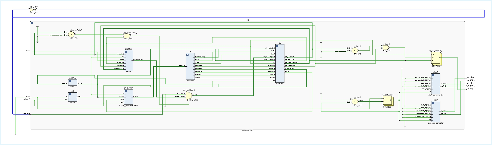
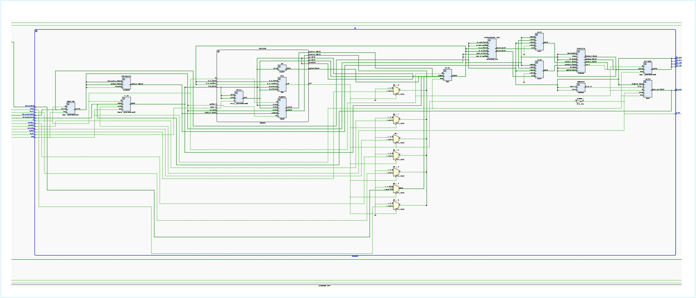
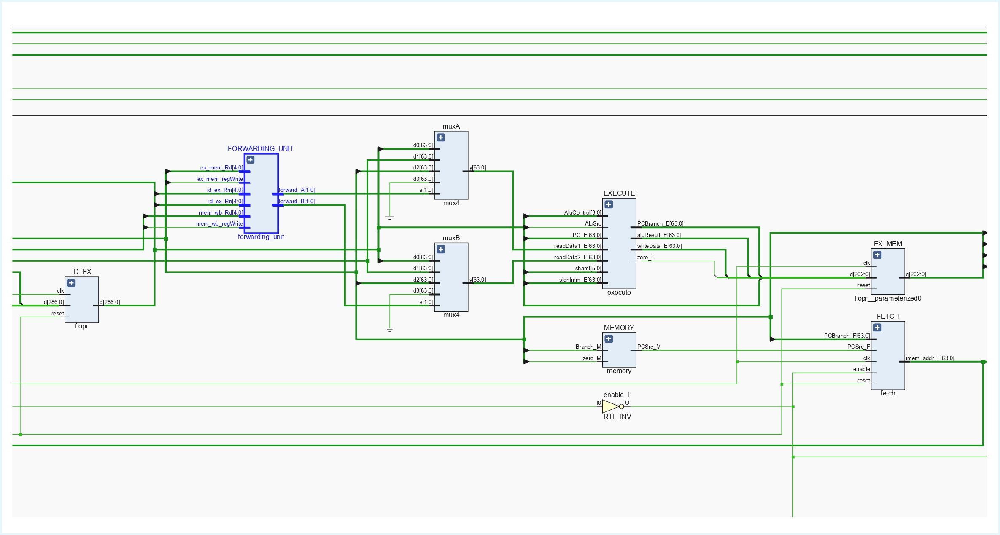
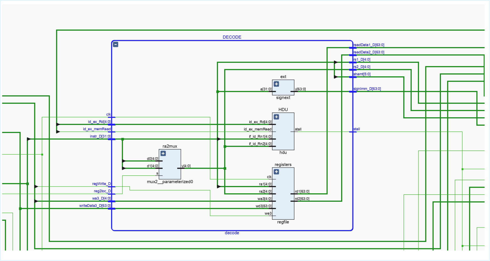
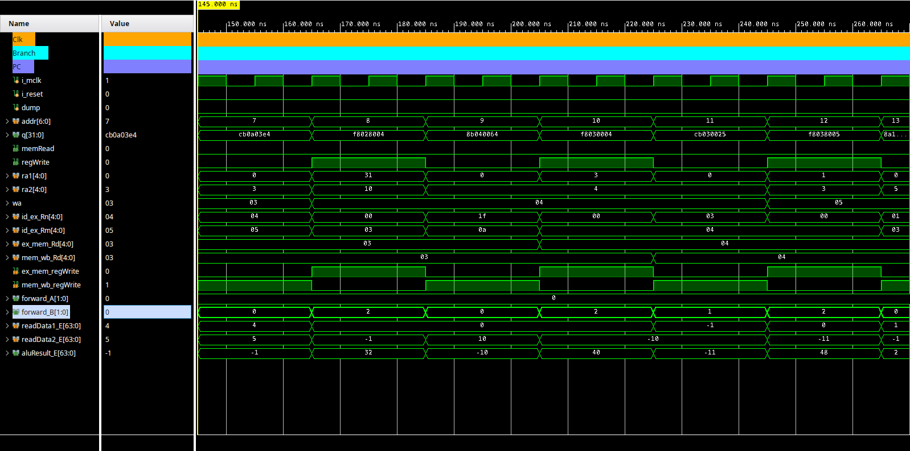
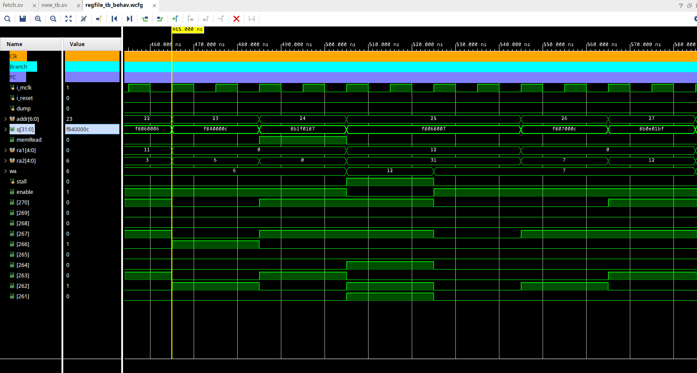

[](https://classroom.github.com/a/ItraukZ2)

# Arquitectura de Computadoras - FAMAF - UNC

## Lab 1: Implementación del procesador LEGv8 con pipeline de 5 etapas

### Integrantes
* Saenz Valiente Gaspar
* Lautaro Deco
* Juan Cruz Hermosilla Artico

##### Ejercicios Resueltos: 1 y 2

### Modificaciones introducidas

Para la implementación de las instrucciones de desplazamiento LSL y LSR, se realizaron modificaciones en la unidad de control, el datapath, la ALU y la ROM.

1. Expansión de la Memoria de Instrucciones (imem.sv):

    Se duplicó la capacidad de la memoria de instrucciones (imem.sv) de 64 a 128 entradas (de 2^6 a 2^7). Esta modificación implicó:
    * Ampliar el puerto de entrada addr a 7 bits (input logic [6:0] addr).
    * Expandir la declaración del array de la ROM a ```logic [N-1:0] ROM [0:127]```.

2. Actualización de decodificadores (maindec.sv y aludec.sv):

    Se actualizó la lógica de control para decodificar y manejar las nuevas instrucciones:

    * maindec.sv: Se modificó el decodificador principal para reconocer los opcodes de LSL y LSR y generar las señales de control (ALUOp) correspondientes para la ALU.

    * aludec.sv: Se extendió el decodificador de la ALU para generar dos nuevas señales alucontrol (ALUOps) a partir de las señales de maindec y el campo funct:

        * 4'b1000: LSL

        * 4'b1001: LSR

3. Modificación del Datapath para el shamt:

    Se implementó el camino de datos necesario para transportar el valor shamt a través del pipeline hasta la ALU:

    * Etapa Decode (decode.sv): Se añadió la lógica para extraer el campo shamt de 6 bits (correspondiente a los bits [15:10] de la instrucción) mediante la asignación:
    ```assign shamt = instr_D[15:10];```

    * Pipeline (datapath.sv): El valor shamt extraído se propaga a la siguiente etapa almacenándolo en el registro de pipeline ID/EX.

    * Etapa Execute (execute.sv): Se lee el valor shamt desde el registro ```(.shamt(qID_EX[276:271]))``` y se conecta a un nuevo puerto de entrada en la ALU.

4. Actualización de la ALU:

    Finalmente, se modificó el módulo alu.sv para que pudiera ejecutar las nuevas operaciones:

    * Se añadió un nuevo puerto de entrada de 6 bits para recibir el valor shamt desde la etapa de ejecución.

    * Se actualizó la lógica interna (case) para que, al recibir las señales alucontrol 4'b1000 (LSL) o 4'b1001 (LSR), la ALU realice la operación de desplazamiento correspondiente utilizando el valor de shamt.

### Codigo test
```asm
.text
.org 0x0000
// ---------------------------------------------------------------------------------------------------------------------------------------------------------------
STUR X1, [X0, #0] // MEM 0:0x1
STUR X2, [X0, #8] // MEM 1:0x2
STUR X3, [X16, #0] // MEM 2:0x3
ADD X3, X4, X5
STUR X3, [X0, #24] // MEM 3:0x9
SUB X3, X4, X5
STUR X3, [X0, #32] // MEM 4:0xFFFFFFFFFFFFFFFF
SUB X4, XZR, X10
STUR X4, [X0, #40] // MEM 5:0xFFFFFFFFFFFFFFF6
ADD X4, X3, X4
STUR X4, [X0, #48] // MEM 6:0xFFFFFFFFFFFFFFF5
SUB X5, X1, X3
STUR X5, [X0, #56] // MEM 7:0x2
AND X5, X10, XZR
STUR X5, [X0, #64] // MEM 8:0x0
AND X5, X10, X3
STUR X5, [X0, #72] // MEM 9:0xA
AND X20, X20, X20
STUR X20, [X0, #80] // MEM 10:0x14
ORR X6, X11, XZR
STUR X6, [X0, #88] // MEM 11:0xB
ORR X6, X11, X3
STUR X6, [X0, #96] // MEM 12:0xFFFFFFFFFFFFFFFF
LDUR X12, [X0, #0]
ADD X7, X12, XZR
STUR X7, [X0, #104] // MEM 13:0x1
STUR X12, [X0, #112] // MEM 14:0x1
ADD XZR, X13, X14
STUR XZR, [X0, #120] // MEM 15:0x0
CBZ X0, L1
ADD XZR, XZR, XZR
ADD XZR, XZR, XZR
ADD XZR, XZR, XZR
STUR X21, [X0, #128] // MEM 16:0x0(si falla CBZ =21)
L1: STUR X21, [X0, #136] // MEM 17:0x15
ADD X2, XZR, X1
L2: SUB X2, X2, X1
ADD X24, XZR, X1
STUR X24, [X0, #144] // MEM 18:0x1 y MEM 19=0x1
ADD X0, X0, X8
CBZ X2, L2
ADD XZR, XZR, XZR
ADD XZR, XZR, XZR
ADD XZR, XZR, XZR
STUR X30, [X0, #144] // MEM 20:0x1E
ADD X30, X30, X30
SUB X21, XZR, X21
ADD X30, X30, X20
LDUR X25, [X30, #-8]
ADD X30, X30, X30
ADD X30, X30, X16
STUR X25, [X30, #-8] // MEM 21:0xA (= MEM 9)

// --- LSL y LSR ---
ADD X2, X1, X1 // X2 = 0x2
LSL X26, X2, #4
STUR X26, [X30, #0] // MEM 22:0x20
LSR X27, X16, #1 // X16 = 0x10
STUR X27, [X30, #8] // MEM 23:0x4
// --- LSL y LSR ---

finloop: CBZ XZR, finloop
ADD XZR, XZR, XZR
ADD XZR, XZR, XZR
ADD XZR, XZR, XZR
```

#### mem.dump:
```text
Memoria RAM de Arm:
Address Data
0 0000000000000000000000000000000000000000000000000000000000000001
1 0000000000000000000000000000000000000000000000000000000000000010
2 0000000000000000000000000000000000000000000000000000000000000011
3 0000000000000000000000000000000000000000000000000000000000001001
4 1111111111111111111111111111111111111111111111111111111111111111
5 1111111111111111111111111111111111111111111111111111111111110110
6 1111111111111111111111111111111111111111111111111111111111110101
7 0000000000000000000000000000000000000000000000000000000000000010
8 0000000000000000000000000000000000000000000000000000000000000000
9 0000000000000000000000000000000000000000000000000000000000001010
10 0000000000000000000000000000000000000000000000000000000000010100
11 0000000000000000000000000000000000000000000000000000000000001011
12 1111111111111111111111111111111111111111111111111111111111111111
13 0000000000000000000000000000000000000000000000000000000000000001
14 0000000000000000000000000000000000000000000000000000000000000001
15 0000000000000000000000000000000000000000000000000000000000000000
16 0000000000000000000000000000000000000000000000000000000000000000
17 0000000000000000000000000000000000000000000000000000000000010101
18 0000000000000000000000000000000000000000000000000000000000000001
19 0000000000000000000000000000000000000000000000000000000000000001
20 0000000000000000000000000000000000000000000000000000000000011110
21 0000000000000000000000000000000000000000000000000000000000001010
22 0000000000000000000000000000000000000000000000000000000000100000
23 0000000000000000000000000000000000000000000000000000000000000100
24 0000000000000000000000000000000000000000000000000000000000000000
25 0000000000000000000000000000000000000000000000000000000000000000
26 0000000000000000000000000000000000000000000000000000000000000000
27 0000000000000000000000000000000000000000000000000000000000000000
28 0000000000000000000000000000000000000000000000000000000000000000
29 0000000000000000000000000000000000000000000000000000000000000000
30 0000000000000000000000000000000000000000000000000000000000000000
31 0000000000000000000000000000000000000000000000000000000000000000
32 0000000000000000000000000000000000000000000000000000000000000000
33 0000000000000000000000000000000000000000000000000000000000000000
34 0000000000000000000000000000000000000000000000000000000000000000
35 0000000000000000000000000000000000000000000000000000000000000000
36 0000000000000000000000000000000000000000000000000000000000000000
37 0000000000000000000000000000000000000000000000000000000000000000
38 0000000000000000000000000000000000000000000000000000000000000000
39 0000000000000000000000000000000000000000000000000000000000000000
40 0000000000000000000000000000000000000000000000000000000000000000
41 0000000000000000000000000000000000000000000000000000000000000000
42 0000000000000000000000000000000000000000000000000000000000000000
43 0000000000000000000000000000000000000000000000000000000000000000
44 0000000000000000000000000000000000000000000000000000000000000000
45 0000000000000000000000000000000000000000000000000000000000000000
46 0000000000000000000000000000000000000000000000000000000000000000
47 0000000000000000000000000000000000000000000000000000000000000000
48 0000000000000000000000000000000000000000000000000000000000000000
49 0000000000000000000000000000000000000000000000000000000000000000
50 0000000000000000000000000000000000000000000000000000000000000000
51 0000000000000000000000000000000000000000000000000000000000000000
52 0000000000000000000000000000000000000000000000000000000000000000
53 0000000000000000000000000000000000000000000000000000000000000000
54 0000000000000000000000000000000000000000000000000000000000000000
55 0000000000000000000000000000000000000000000000000000000000000000
56 0000000000000000000000000000000000000000000000000000000000000000
57 0000000000000000000000000000000000000000000000000000000000000000
58 0000000000000000000000000000000000000000000000000000000000000000
59 0000000000000000000000000000000000000000000000000000000000000000
60 0000000000000000000000000000000000000000000000000000000000000000
61 0000000000000000000000000000000000000000000000000000000000000000
62 0000000000000000000000000000000000000000000000000000000000000000
63 0000000000000000000000000000000000000000000000000000000000000000
```

### Diagrama de bloques general del procesador
#### Processor


#### Datapath


#### Forwarding 


#### Decode



### Verificación y Programa GPIO (Ejercicio 1)

Para cumplir con los requisitos del Ejercicio 1, se realizaron dos pruebas de software.

#### 1\. Código de Prueba 

Antes de implementar el juego de luces, se utilizó el código de prueba base provisto en la guía del laboratorio. Se le agregaron instrucciones `LSL` y `LSR` para verificar que las nuevas operaciones funcionaban correctamente junto con las instrucciones existentes (`ADD`, `SUB`, `LDUR`, `STUR`, etc.).

También se insertaron manualmente 3 (tres) instrucciones `NOP` (`ADD XZR, XZR, XZR`) después de cada `LDUR` para evitar el *hazard de datos de tipo load-use*, confirmando que el pipeline funcionaba como se esperaba.

#### 2\. Programa Assembly "Juego de Luces" (GPIO)

Se implementó el siguiente programa en `main.s` para controlar los LEDs de la placa.

**Explicación del Funcionamiento:**

Este programa implementa un efecto de luz simple que mueve un único LED desde la posición 0 (derecha) hasta la posición 15 (izquierda).

1.  **Inicialización:**

      * `LSL X10, X1, #15`: Carga la dirección base del GPIO (`0x8000`) en `X10`. Se asume que `X1` vale `1` (precargado por el `regfile.sv`).
      * `ADD X15, X10, XZR`: Copia el valor `0x8000` a `X15`, que se usará como centinela para detectar el final.
      * `ADD X12, X1, XZR`: Inicializa el estado del LED. `X12` (el registro de los LEDs) empieza en `1` (LED 0 encendido).
      * `LSL`/`ADD`: Se calcula un valor de *delay* de 40960 ciclos y se guarda en `X14`.

2.  **Bucle Principal (`MAIN_LOOP`):**

      * `STUR X12, [X10, #0]`: Escribe el valor actual de `X12` en la dirección de los LEDs (`0x8000`), encendiéndolos.
      * `SUB X20, X12, X15`: Compara el LED actual (`X12`) con el valor final (`X15 = 0x8000`).
      * `CBZ X20, FINISH`: Si son iguales (el LED llegó al final), salta a `FINISH`.
      * `ADD X13, X14, XZR`: Carga el valor del *delay* en `X13`.
      * `DELAY_LOOP`: Se ejecuta un bucle de espera (delay) hasta que `X13` es 0.
      * `LSL X12, X12, #1`: Desplaza el bit del LED una posición a la izquierda.
      * `CBZ XZR, MAIN_LOOP`: Vuelve al inicio del bucle.

3.  **Final (`FINISH`):**

      * `CBZ XZR, FINISH`: El programa entra en un bucle infinito, dejando el LED 15 encendido.

**Código `main.s`:**

```armasm
.global _start
.text
_start:

    LSL X10, X1, #15
    
    ADD X15, X10, XZR
    
    ADD X12, X1, XZR
    
    LSL X14, X1, #15
    LSL X13, X1, #13
    ADD X14, X14, X13
    

MAIN_LOOP:

    STUR X12, [X10, #0]
    
    SUB X20, X12, X15
    CBZ X20, FINISH
    SUB XZR, XZR, XZR
    SUB XZR, XZR, XZR
    SUB XZR, XZR, XZR
    
    ADD X13, X14, XZR

DELAY_LOOP:
    CBZ X13, END_DELAY
    SUB XZR, XZR, XZR
    SUB XZR, XZR, XZR
    SUB XZR, XZR, XZR
    
    SUB X13, X13, X1
    CBZ XZR, DELAY_LOOP
    SUB XZR, XZR, XZR
    SUB XZR, XZR, XZR
    SUB XZR, XZR, XZR
END_DELAY:

    LSL X12, X12, #1
    
    CBZ XZR, MAIN_LOOP
    SUB XZR, XZR, XZR
    SUB XZR, XZR, XZR
    SUB XZR, XZR, XZR    
FINISH:
    CBZ XZR, FINISH
```


### Funcionamiento Forwarding Unit y Hazard Detection Unit

#### Forwarding Unit

```asm
SUB X4, XZR, X10
STUR X4, [X0, #40] *// MEM 5:0xFFFFFFFFFFFFFFF6*
ADD X4, X3, X4
```
En el ciclo de reloj que comienza en 145 ns, se hace fetch de la instrucción SUB X4, XZR, X10.

En el siguiente ciclo, se hace fetch de STUR X4, [X0, #40] y se decodifica la instrucción SUB, donde se observa ra1 = 31, ra2 = 10, wa = 4.

En el ciclo siguiente, se ejecuta SUB y se decodifica STUR.

En el ciclo posterior, la instrucción SUB se encuentra en la etapa MEM y se ejecuta STUR.

En este momento, la forwarding unit entra en acción. Observa los inputs que recibe: id_ex_Rm = 4, ex_mem_Rd = 4 y ex_mem_regWrite = 1. Detecta la dependencia de datos RAW y envía la señal forward_B = 01 para que la entrada a la ALU en readData_2 sea el resultado de haber ejecutado el SUB (−10).

#### Hazard Detection Unit


```asm
STUR X6, [X0, #96] // MEM 12:0xFFFFFFFFFFFFFFFF
LDUR X12, [X0, #0]
ADD X7, X12, XZR
STUR X7, [X0, #104] // MEM 13:0x1
STUR X12, [X0, #112] // MEM 14:0x1
```

Como se ve en el código, existe una dependencia RAW entre la instrucción LDUR X12, [X0, #0] y ADD X7, X12, XZR, donde la HDU debe intervenir para insertar un stall.

En el flanco ascendente de clock en 465 ns, se hace fetch de la instrucción LDUR X12, [X0, #0].

En el siguiente clock, se decodifica esa instrucción, donde observamos memRead en 1. A su vez, se hace fetch de la instrucción ADD X7, X12, XZR.

En el siguiente clock, se ejecuta LDUR y se decodifica ADD. En este momento, la HDU recibe memRead y Rd provenientes de qID_EX, y Rn y Rm provenientes de la instrucción ADD decodificada.

La HDU verifica que Rd == Rn, Rn ≠ XZR y memRead == 1, por lo que envía la señal Stall. Esto deshabilita el enable del registro IF_ID y IF_ID_TOP para mantener el PC y la instrucción fetcheada. Como se puede ver, el ADD (f8068007) permanece un ciclo de clock extra en fetch mientras que todas las señales de control se ponen en 0.